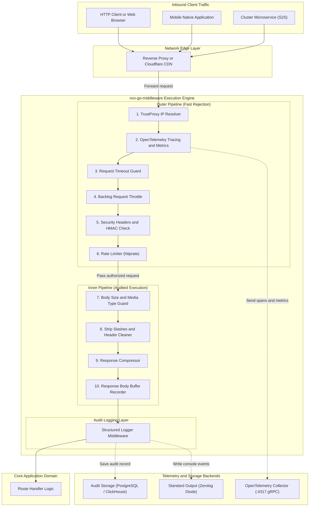
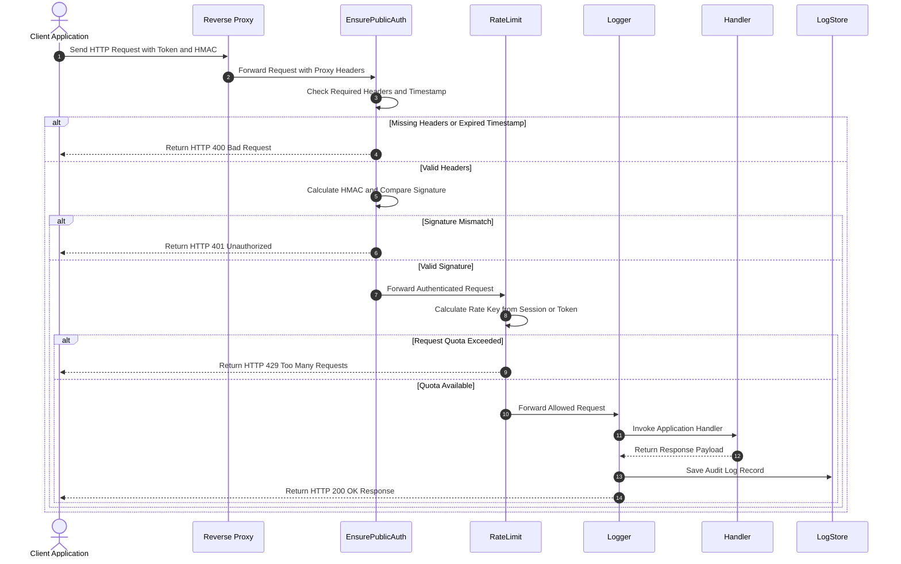
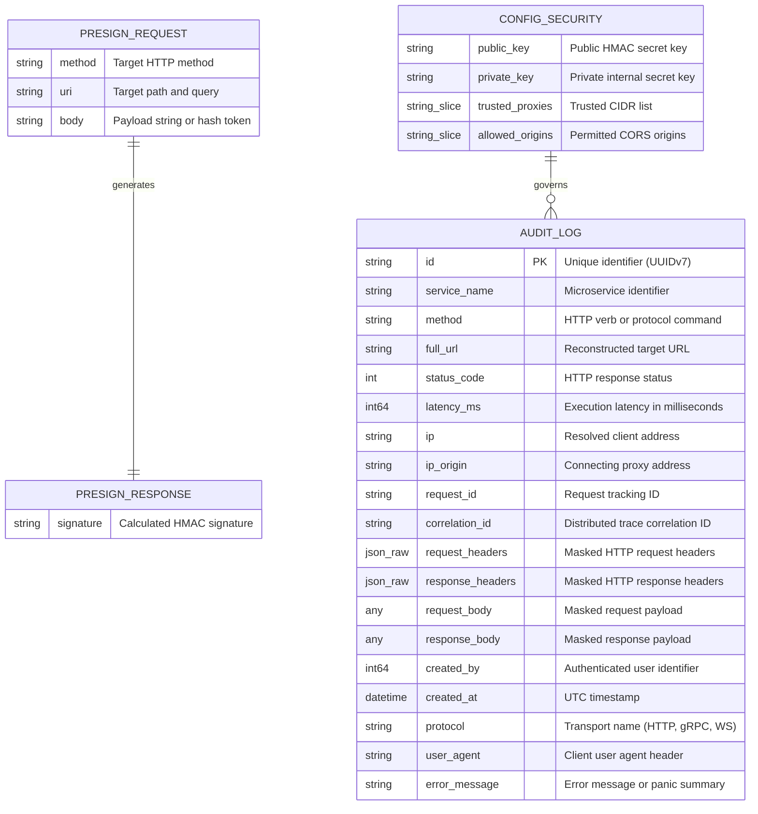
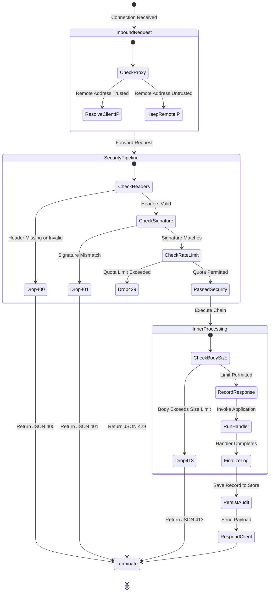

# nvx-go-middleware

[](https://pkg.go.dev/github.com/Jkenyut/nvx-go-middleware)
[](https://goreportcard.com/report/github.com/Jkenyut/nvx-go-middleware)
[](LICENSE)
[](#8-verification-testing-and-health-check)

The `nvx-go-middleware` package provides server middleware for Go microservices.
It supports HTTP, gRPC, and WebSocket transports.
The library executes fast rejection of invalid requests before audit logging.
This architecture saves CPU cycles, memory allocations, and storage operations.

---

## 1. System Architecture and Data Flows

The system architecture connects edge proxies, security middleware layers, application handlers, and telemetry sinks.

### 1.1 System Topology and Component Architecture



The outer pipeline checks request authenticity before logging runs.
The engine drops invalid requests at the outer layer.
This behavior prevents audit storage pollution during denial of service spikes.

---

### 1.2 Core Transaction Workflow



The client sends authentication tokens and cryptographic signatures in request headers.
The proxy resolver identifies the original client address.
The authentication guard rejects malformed requests immediately.
The rate limiter calculates quota limits with session keys.
The logging module records complete audit records after application execution.

---

## 2. Data Schema and Lifecycle Operations

The middleware structures audit log entries and presigned signature payloads.

### 2.1 Data Entity Relationship Model



The audit log structure captures transport, security, and timing metadata.
Sensitive fields undergo keyword masking before JSON serialization.

---

### 2.2 Request Lifecycle State Machine



The state machine enforces ordered security checkpoints.
Failed checkpoints terminate requests with standard JSON error envelopes.
Passed requests reach application handlers and persist structured audit logs.

---

## 3. Prerequisites and Tooling

Install the verified tools listed in the table below:

| Requirement | Supported Version | Functional Role |
| :--- | :--- | :--- |
| Go Toolchain | 1.24+ / 1.26+ | Compiles the middleware module and executes test suites. |
| OpenTelemetry Collector | 0.95.0+ | Receives distributed traces and server metric points. |
| Docker Engine | 26.0+ | Hosts local test containers and infrastructure. |
| Docker Compose | v2.26+ | Runs multi-container dependency environments. |
| GolangCI-Lint | v1.60+ | Executes static code analysis and lint gates. |

---

## 4. Directory Structure

The repository maintains modular separation between transports, chains, and storage backends:

```text
.
├── .github/                # Stores GitHub Actions continuous integration workflows.
│   └── workflows/
│       └── ci.yml          # Runs build, test, and race detection checks.
├── constants/              # Declares shared constants.
│   └── constants.go        # Defines headers, error messages, and defaults.
├── docs/                   # Stores technical reference documents.
│   └── ARCHITECTURE.md     # Documents pipeline mechanics and sequence diagrams.
├── examples/               # Contains runnable integration programs.
│   ├── advanced/           # Demonstrates complete Chi server configuration.
│   ├── basic/              # Demonstrates lightweight standard library routing.
│   ├── client_signature/   # Shows signature generation in TypeScript.
│   └── grpc_server/        # Shows gRPC server interceptor integration.
├── model/                  # Declares shared data schemas.
│   ├── audit_log.go        # Defines the AuditLog data struct.
│   └── presign.go          # Defines presigned request and response models.
├── chain.go                # Implements pre-built middleware chain profiles.
├── chi.go                  # Implements Chi adapters and rate limiters.
├── config.go               # Defines configuration structures and validators.
├── CONTRIBUTING.md         # Explains branch models and contribution rules.
├── go.mod                  # Declares dependencies and Go version.
├── go.sum                  # Contains dependency checksum records.
├── graphql.go              # Implements GraphQL depth and operation middleware.
├── grpc.go                 # Implements gRPC unary and stream interceptors.
├── LICENSE                 # Contains the Apache 2.0 software license.
├── logger.go               # Declares logging interfaces and Zerolog adapter.
├── Makefile                # Declares development build and test targets.
├── manager.go              # Implements the Manager struct and constructors.
├── metrics.go              # Implements OpenTelemetry HTTP server metrics.
├── middleware.go           # Implements core HTTP security and audit handlers.
├── middleware_test.go      # Validates HTTP middleware execution pipelines.
├── options.go              # Declares functional options for configurations.
├── options_test.go         # Validates option builders and configuration merging.
├── README.md               # Documents system architecture and instructions.
├── response_writer.go      # Implements pooled response body recording.
├── store.go                # Implements LogStore and multi-store broadcasting.
├── store_test.go           # Validates storage backends and concurrent persistence.
└── ws.go                   # Implements WebSocket upgrade security checks.
```

---

## 5. Configuration Parameters

Configure the middleware manager with functional options or configuration structs:

| Configuration Key | Type | Default Value | Description (ASD-STE100) |
| :--- | :--- | :--- | :--- |
| `core.env` | string | `"development"` | Sets the runtime environment name. |
| `core.serviceName` | string | `"unknown-service"` | Sets the service identifier for tracing. |
| `core.enableTelemetry` | boolean | `false` | Enables OpenTelemetry traces and metrics. |
| `security.publicKeySignature` | string | `""` | Sets the public HMAC secret key. |
| `security.privateKeySignature` | string | `""` | Sets the private internal secret key. |
| `security.trustedProxies` | string slice | `[]` | Sets trusted proxy IPs and CIDR blocks. |
| `security.allowedOrigins` | string slice | `["*"]` | Sets permitted origins for CORS checks. |
| `security.allowedContentTypes` | string slice | `["application/json", ...]` | Sets accepted HTTP request media types. |
| `security.signatureTimestampExpiredMs` | integer | `600000` | Sets permitted clock drift in milliseconds. |
| `limits.requestTimeoutMs` | integer | `60000` | Sets request context cancellation timeouts. |
| `limits.requestBodyLimitSize` | integer | `2147483648` (2 GB) | Sets maximum file upload limits. |
| `limits.requestBodyNonFileLimitSize` | integer | `3145728` (3 MB) | Sets maximum non-file request limits. |
| `logging.logRequestBodies` | boolean | `false` | Enables request payload logging. |
| `logging.logResponseBodies` | boolean | `false` | Enables response payload logging. |
| `logging.responseBodyLogLimitSize` | integer | `5242880` (5 MB) | Sets maximum logged response bytes. |
| `logging.logStoreTimeoutMs` | integer | `5000` | Sets the audit persistence timeout. |

---

## 6. Installation and Execution Procedure

Follow these procedural steps to install, configure, and execute the service.

### Step 1: Install Package Dependency

Run the Go module command in your terminal:

```bash
go get github.com/Jkenyut/nvx-go-middleware
```

### Step 2: Initialize Manager with Options

Create the manager instance in your application entry point:

```go
package main

import (
	"log"
	"net/http"

	"github.com/Jkenyut/nvx-go-middleware"
	"github.com/go-chi/chi/v5"
)

func main() {
	// Initialize the middleware manager using functional options
	mgr, err := middleware.New(
		middleware.WithServiceName("order-service"),
		middleware.WithEnv("production"),
		middleware.WithTelemetry(true),
		middleware.WithSecurityKeys("public-secret-key", "private-secret-key"),
		middleware.WithTrustedProxies("10.0.0.0/8", "172.16.0.0/12"),
		middleware.WithAllowedOrigins("https://app.example.com"),
	)
	if err != nil {
		log.Fatalf("failed to initialize middleware: %v", err)
	}
	defer mgr.Close()

	r := chi.NewRouter()

	// Apply public route chain with device checks and IP rate limits
	r.Use(mgr.PublicChain())

	r.Get("/products", func(w http.ResponseWriter, r *http.Request) {
		w.Header().Set("Content-Type", "application/json")
		w.Write([]byte(`[{"id":"prod-1","name":"Item"}]`))
	})

	log.Println("Server listening on :8080")
	if err := http.ListenAndServe(":8080", r); err != nil {
		log.Fatalf("server stopped: %v", err)
	}
}
```

---

## 7. API and Operational Interface

The table summarizes primary middleware functions and pre-built chains:

| Function Interface | Operational Area | Functional Role (ASD-STE100) |
| :--- | :--- | :--- |
| `middleware.New(opts...)` | Manager Lifecycle | Starts the manager with functional options. |
| `middleware.NewWithError(cfg)` | Manager Lifecycle | Starts the manager from a configuration struct. |
| `mgr.PublicChain(opts...)` | Route Chain | Creates a chain for unauthenticated routes. |
| `mgr.PublicAuthChain(opts...)` | Route Chain | Creates a chain for authenticated user routes. |
| `mgr.PublicAPIKeyChain(opts...)` | Route Chain | Creates a chain for external API key routes. |
| `mgr.InternalChain(opts...)` | Route Chain | Creates a chain for service-to-service routes. |
| `mgr.PreSignChain(opts...)` | Route Chain | Creates a chain for request presigning endpoints. |
| `mgr.WebhookChain(opts...)` | Route Chain | Creates a chain for high-volume webhook ingestion. |
| `mgr.GraphQLChain(opts...)` | GraphQL Adapter | Applies depth checks and extracts operation names. |
| `mgr.WebSocketChain(opts...)` | WebSocket Adapter | Enforces pre-upgrade origin and authentication checks. |
| `mgr.NewGRPCServer(opts...)` | gRPC Factory | Creates a server with traces, metrics, and recovery. |
| `mgr.ServerMetrics()` | Observability | Records latency histograms and request counters. |
| `mgr.DefaultCORS()` | Security | Handles CORS preflight and origin verification. |
| `mgr.MaxBodySize(opts...)` | Security | Rejects request payloads that exceed limits. |
| `middleware.MultiLogStore(s...)` | Persistence | Broadcasts audit logs concurrently across multiple stores. |

### Advanced Transport Integrations

#### gRPC Service Factory
```go
// Creates a gRPC server configured with trace handlers and interceptors
grpcServer := mgr.NewGRPCServer()
```

#### GraphQL Endpoint Adapter
```go
// Applies query depth limits and logs GraphQL operations
router.Handle("/graphql", mgr.GraphQLChain(
	middleware.WithGraphQLMaxDepth(10),
)(graphqlHandler))
```

#### WebSocket Upgrade Adapter
```go
// Checks origin headers and credentials before upgrading connection
router.Handle("/ws", mgr.WebSocketChain(
	middleware.WithWSAuthenticator(func(r *http.Request) bool {
		return r.URL.Query().Get("token") != ""
	}),
)(wsHandler))
```

---

## 8. Verification, Testing and Health Check

Execute verified commands to check correctness, memory safety, and code style.

### Step 1: Run Unit Tests with Race Detection

Execute the unit test suite:

```bash
go test -count=1 -race ./...
```

### Step 2: Run Micro-Benchmarks

Measure execution speed and memory allocations:

```bash
go test -run=^$ -bench=. -benchmem ./...
```

### Step 3: Run Static Code Analysis

Execute static analysis checks:

```bash
go vet ./...
```

---

## 9. Troubleshooting and Fault Isolation

Review the table below to resolve common configuration and runtime errors:

| Observed Symptom | Probable Root Cause | Corrective Action (ASD-STE100) |
| :--- | :--- | :--- |
| `missing required headers` | Client request omitted mandatory tracking headers. | Send `X-Request-Id`, `X-Platform`, and `X-Timestamp`. |
| `invalid request signature` | HMAC signature mismatch or clock drift exceeded. | Check the secret key and synchronize the device clock. |
| `request payload too large` | Request body exceeded configured size limits. | Increase `RequestBodyLimitSize` or reduce payload size. |
| `cross-origin websocket forbidden` | WebSocket handshake sent an unlisted origin header. | Add the client origin to `AllowedOrigins`. |
| Audit logs show missing response body. | Response body size exceeded logging byte limits. | Increase `ResponseBodyLogLimitSize` in configuration. |
| High Prometheus memory consumption. | Unparameterized URL paths entered metric labels. | Inject route patterns using `WithRoutePattern`. |
| Buffer dropped warning in console logs. | High traffic saturated the diode ring buffer. | Increase diode ring capacity or use async stores. |

---

## 10. License

This project is licensed under the Apache License 2.0. Refer to [LICENSE](LICENSE) for full legal terms.
