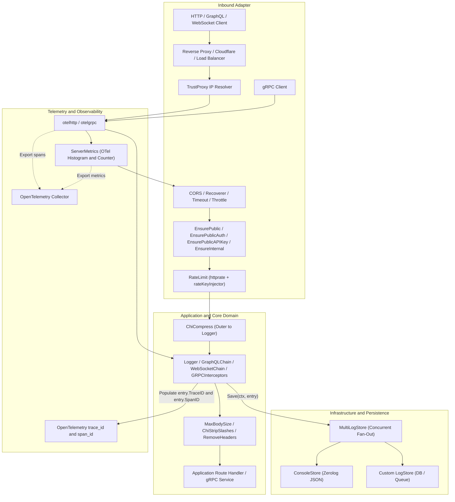
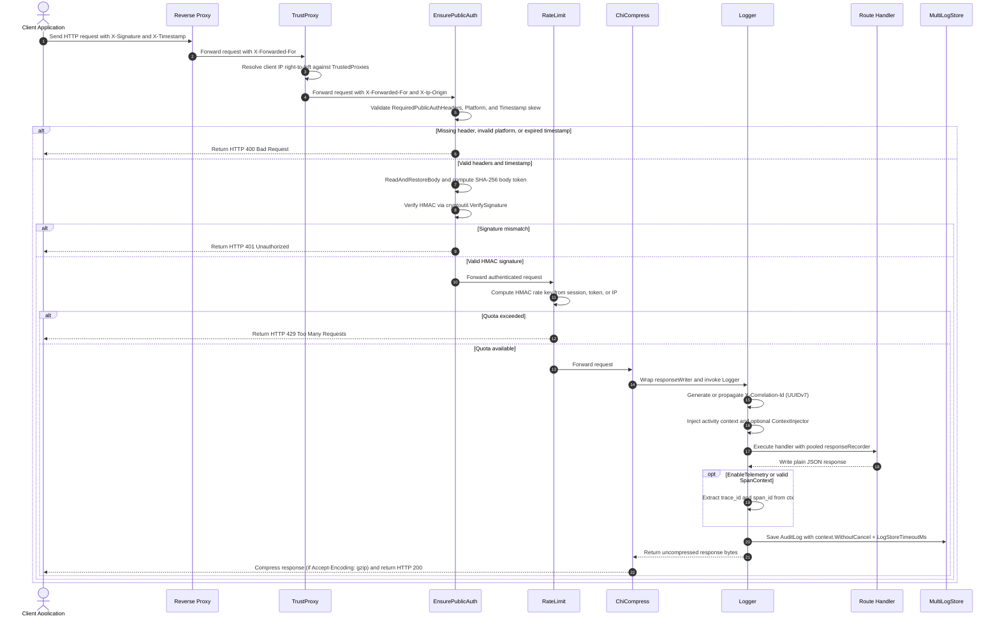
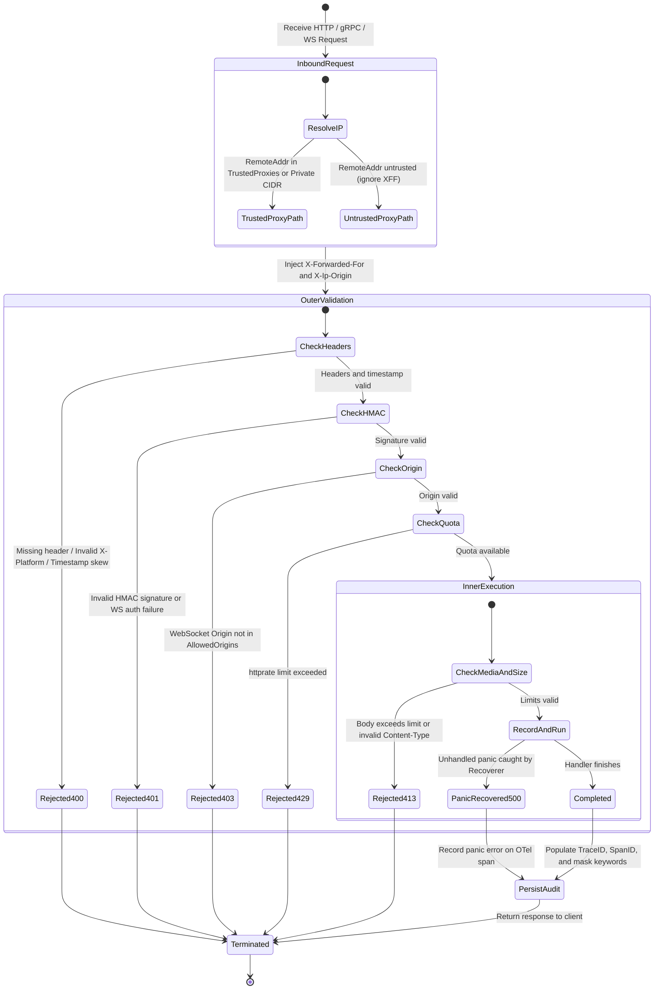
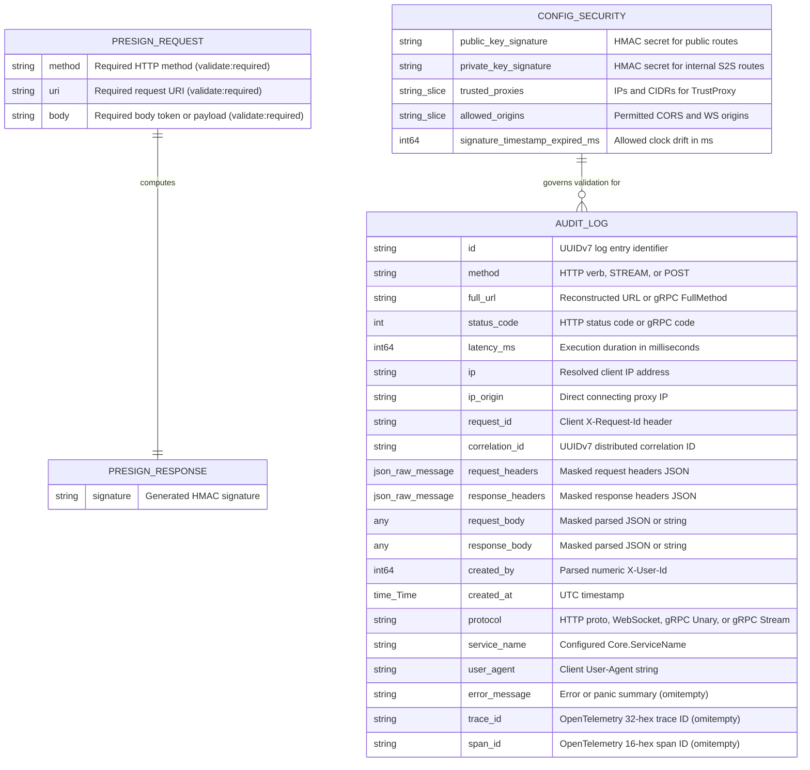

# nvx-go-middleware

[](https://pkg.go.dev/github.com/Jkenyut/nvx-go-middleware)
[](LICENSE)

`nvx-go-middleware` provides Go server middleware for HTTP, GraphQL, WebSocket, and gRPC transports.
The library validates inbound headers, timestamps, HMAC signatures, rate limits, and payload bounds before application handlers execute.
Invalid requests terminate at the outer pipeline layer before audit logging or downstream storage I/O runs.

---

## 1. System Architecture and Data Flows

### 1.1 System Topology (`flowchart TD`)



The outer pipeline rejects unauthenticated, expired, or rate-limited requests before body buffering or audit persistence runs.
In `buildInnerChain` ([chain.go](chain.go)), `ChiCompress` wraps outside `Logger` so `Logger` captures plain JSON response bodies before `ChiCompress` compresses the payload for the client.

---

### 1.2 Core Workflows (`sequenceDiagram`)



---

### 1.3 Request Lifecycle State Machine (`stateDiagram-v2`)



---

### 1.4 Domain and Persistence Schema (`erDiagram`)

This repository is a Go middleware library. It contains no `migrations/` directory or SQL database DDL.
The diagram below maps the exact Go domain structs in [model/audit_log.go](model/audit_log.go), [model/presign.go](model/presign.go), and [config.go](config.go).



---

## 2. Deep Engineering and Storage Trade-Offs

### 2.1 `ChiCompress` Outer to `Logger` ([chain.go](chain.go))

`buildInnerChain` applies `m.Logger(handler)` inside `m.ChiCompress(...)`:

```go
handler = m.RemoveHeaders(handler)

// Logger only records requests that survived Outer layers (DDoS, Bad Auth)
// and sits inside ChiCompress so it captures plain (uncompressed) response bodies.
handler = m.Logger(handler)

if cfg.Features.UseChiCompress {
	handler = m.ChiCompress(cfg.Compression.CompressionLevel)(handler)
}
```

Placing `Logger` inside `ChiCompress` ensures `responseRecorder` captures uncompressed JSON bytes for `AuditLog.ResponseBody` while `ChiCompress` compresses the wire payload for clients sending `Accept-Encoding: gzip`.

### 2.2 Pooled `responseRecorder` with 64 KB Cap ([response_writer.go](response_writer.go))

`wrapResponseWriter` reuses `*bytes.Buffer` instances via `sync.Pool` and bounds captured bytes by `ResponseBodyLogLimitSize`:

```go
const maxPooledBufferSize = 64 * 1024 // 64 KB

func (r *responseRecorder) Free() {
	if r.body != nil {
		if r.body.Cap() <= maxPooledBufferSize {
			r.body.Reset()
			responseBufferPool.Put(r.body)
		}
		r.body = nil
	}
}
```

Buffers exceeding 64 KB drop out of the pool so large responses do not pin oversized heap allocations across requests.

### 2.3 Detached Audit Persistence with Trace Preservation ([manager.go](manager.go))

`Manager.saveAuditLog` extracts `TraceID` and `SpanID` before detaching cancellation via `context.WithoutCancel(ctx)`:

```go
entry.TraceID = cmp.Or(entry.TraceID, telemetry.TraceID(ctx))
entry.SpanID = cmp.Or(entry.SpanID, telemetry.SpanID(ctx))
timeoutMs := m.cfg.Logging.LogStoreTimeoutMs
if timeoutMs <= 0 {
	timeoutMs = constants.DefaultLogStoreTimeoutMs
}
saveCtx, cancel := context.WithTimeout(context.WithoutCancel(ctx), time.Duration(timeoutMs)*time.Millisecond)
defer cancel()
return m.cfg.LogStore.Save(saveCtx, entry)
```

This guarantees audit persistence completes even if the client disconnects early, retains OpenTelemetry `SpanContext` values, and bounds storage latency with `LogStoreTimeoutMs`.

### 2.4 Right-to-Left `X-Forwarded-For` Traversal and Pre-Parsed `netip` ([manager.go](manager.go), [middleware.go](middleware.go))

`initTrustedProxies` pre-parses `TrustedProxies` into `map[netip.Addr]struct{}` and `[]netip.Prefix` during `New(...)`.
At request time, `resolveClientIP` walks `X-Forwarded-For` from right to left (`slices.Backward(parts)`) and selects the first IP not in trusted or private networks.
If `RemoteAddr` is untrusted, `TrustProxy` ignores client-supplied forwarding headers to prevent IP spoofing.

### 2.5 Non-Destructive Body Inspection ([middleware.go](middleware.go))

`ReadAndRestoreBody` reads at most `limit + 1` bytes via `io.LimitReader(r.Body, limit+1)` so `EnsurePublic*` can hash the body (`ResolveBodyToken`) and restore `r.Body` via `io.NopCloser` (or `io.MultiReader` when over limit) for downstream handlers.
Multipart uploads return `nil, nil` and skip buffering.

### 2.6 Concurrent `MultiLogStore` Fan-Out ([store.go](store.go))

`MultiLogStore` flattens nested multi-stores, executes `Save` concurrently across all configured `LogStore` backends using `sync.WaitGroup`, and aggregates failures with `errors.Join`.

---

## 3. Source-Verified Reference Catalogs

### 3.1 Business Metric and Telemetry Catalog

Metrics are registered in [metrics.go](metrics.go) via `telemetry.NewMetricManager`.

| Metric Name | Instrument Type | Unit | Monitored Attributes | Description (ASD-STE100) |
| :--- | :--- | :--- | :--- | :--- |
| `http.server.request.duration` | `Float64Histogram` | `s` | `http.request.method`, `http.route`, `http.response.status_code` | Records HTTP request execution latency across explicit bucket boundaries (`0.005` to `5` seconds). |
| `http.server.requests.total` | `Int64Counter` | `1` | `http.request.method`, `http.route`, `http.response.status_code` | Counts total processed HTTP server requests. |

OpenTelemetry spans also record attributes in [middleware.go](middleware.go), [graphql.go](graphql.go), [ws.go](ws.go), and [grpc.go](grpc.go): `service`, `correlation_id`, `request_id`, `ip`, `ip_origin`, `user_id`, `user_agent`, `path` (HTTP), `protocol`, `header_auth_type` (HTTP), `graphql.operation.name` (GraphQL), and `http.target` (WebSocket).

---

### 3.2 HTTP Header and Gateway Contract

Headers are defined in [constants/constants.go](constants/constants.go) and mapped via `HeaderKeys` in [config.go](config.go).

| Header Name | Required | Origin / Context | Functional Role (ASD-STE100) |
| :--- | :--- | :--- | :--- |
| `X-Request-Id` | Yes (Public, Auth, APIKey, Internal, PreSign) | Client or API Gateway | Identifies individual requests for tracing and `activity` context. |
| `X-Correlation-Id` | Auto-generated if empty | Gateway or Middleware | Propagates UUIDv7 distributed correlation across services. |
| `X-Platform` | Yes (Public, Auth, APIKey, Internal, PreSign) | Client | Validates client platform against `mobile`, `web`, `desktop`, `server`, `other`. |
| `X-Timestamp` | Yes (Public, Auth, APIKey, Internal, PreSign) | Client | Supplies Unix timestamp checked against `SignatureTimestampExpiredMs`. |
| `X-Signature` | Yes (Public, Auth, APIKey, Internal) | Client | Supplies HMAC signature verified by `cryptoutil.VerifySignature`. |
| `X-App-Id` | Yes (Public, Auth, APIKey, Public PreSign) | Client | Identifies client application and scopes rate limit keys. |
| `User-Agent` | Yes (Public) | Client | Identifies client user agent and logs request origin metadata. |
| `X-Token` | Yes (PublicAuth) | Client | Supplies user authentication token for `PublicAuthChain`. |
| `X-Session-ID` | Optional | Client | Scopes `PublicAuth` rate limit keys when present. |
| `X-Api-Key` | Yes (PublicAPIKey) | Client | Authenticates external API key consumers and scopes rate limits. |
| `X-User-Id` | Optional | Auth / Gateway | Populates `AuditLog.CreatedBy`, `activity` context, and span attributes. |
| `X-Forwarded-For` | Proxy-populated | Reverse Proxy / `TrustProxy` | Carries client IP chain; `TrustProxy` overwrites it with resolved client IP. |
| `X-Ip-Origin` | Middleware-populated | `TrustProxy` | Stores direct connecting proxy or peer IP address. |
| `X-Auth-Type` | Middleware-populated | `SetHeaderAuthType` | Marks active auth zone (`public`, `public-auth`, `public-api-key`, `internal`). |
| `X-Rate-Key` | Middleware-populated | `rateKeyInjector` | Stores computed HMAC rate limit key for `httprate`. |
| `CF-Connecting-IP` | Optional | Cloudflare Edge | Supplies authoritative client IP when `RemoteAddr` is trusted. |
| `X-Real-Ip` | Optional | Reverse Proxy | Supplies fallback client IP when `CF-Connecting-IP` and `XFF` do not match. |
| `X-GraphQL-Operation` | Middleware-populated | `GraphQLChain` | Stores extracted GraphQL `operationName` or `"anonymous"`. |

---

### 3.3 Configuration and Environment Matrix

`nvx-go-middleware` loads configuration via Go structs (`Config` in [config.go](config.go) and `ChainConfig` in [chain.go](chain.go)) with `yaml` and `default` struct tags, plus functional `Option` / `ChainOption` builders in [options.go](options.go). This repository does not read `.env` files or provide a `config.template.yaml`.

| Config YAML Path | Go Type | Default Value | Description (ASD-STE100) |
| :--- | :--- | :--- | :--- |
| `core.env` | `string` | `"development"` | Sets runtime environment; `"prod"` or `"production"` hides missing header names in 400 errors. |
| `core.serviceName` | `string` | `"unknown-service"` | Sets service name for logs, `AuditLog.ServiceName`, and OpenTelemetry spans. |
| `core.enableTelemetry` | `bool` | `false` | Enables `otelhttp`, `otelgrpc`, `ServerMetrics`, and span attribute recording. |
| `limits.requestTimeoutMs` | `int64` | `60000` | Sets request timeout duration in milliseconds when `UseChiTimeout` is enabled. |
| `limits.requestBodyLimitSize` | `int64` | `2147483648` (2 GB) | Sets maximum multipart upload body size in bytes. |
| `limits.requestBodyNonFileLimitSize` | `int64` | `3145728` (3 MB) | Sets maximum non-file request body size in bytes. |
| `logging.logRequestBodies` | `bool` | `false` | Enables capturing and masking request bodies in `AuditLog`. |
| `logging.logResponseBodies` | `bool` | `false` | Enables capturing and masking response bodies in `AuditLog`. |
| `logging.responseBodyLogLimitSize` | `int64` | `5242880` (5 MB) | Sets maximum response body bytes buffered per request. |
| `logging.logStoreTimeoutMs` | `int64` | `5000` | Sets timeout in milliseconds for `LogStore.Save`. |
| `logging.maskKeywords` | `[]string` | `format.DefaultMaskKeywords` | Appends sensitive field names masked with `"*"` in logs. |
| `logging.logHeaders` | `[]string` | `["X-Request-Id", "X-Correlation-Id", "X-Forwarded-For", "X-Ip-Origin", "X-User-Id"]` | Selects request headers attached to error log events. |
| `security.publicKeySignature` | `string` | `""` (Required) | Sets HMAC secret key for public and presign endpoints. |
| `security.privateKeySignature` | `string` | `""` (Required) | Sets HMAC secret key for internal service-to-service endpoints. |
| `security.trustedProxies` | `[]string` | `[]` | Lists trusted proxy IPs and CIDRs for `TrustProxy`. |
| `security.allowedOrigins` | `[]string` | `["*"]` | Lists permitted origins for CORS and WebSocket upgrades. |
| `security.allowedContentTypes` | `[]string` | `["application/json", "multipart/form-data"]` | Lists permitted request media types in `MaxBodySize`. |
| `security.allowedHeaders` | `[]string` | `["Accept", "Authorization", "Content-Type", ...required headers]` | Sets `Access-Control-Allow-Headers` for CORS responses. |
| `security.headersToRemove` | `[]string` | `[]` | Lists response headers deleted by `RemoveHeaders`. |
| `security.signatureTimestampExpiredMs` | `int64` | `600000` (10 min) | Sets maximum allowed timestamp drift in milliseconds. |
| `features.useChiCompress` | `bool` | `true` | Enables gzip compression outer to `Logger` in `buildInnerChain`. |
| `features.useChiTimeout` | `bool` | `false` | Enables `ChiTimeout` in `buildOuterChain`. |
| `features.useChiThrottle` | `bool` | `false` | Enables `ChiThrottleBacklog` in `buildOuterChain`. |
| `features.useChiRateLimitAuth` | `bool` | `false` | Enables `RateLimit` on `PublicAuthChain`, `PublicAPIKeyChain`, and `ProtectedRateLimitChain`. |
| `features.useChiRateLimitPublic` | `bool` | `false` | Enables `RateLimit` on `PublicChain`, `PreSignChain`, and `PublicRateLimitChain`. |
| `features.useChiStripSlashes` | `bool` | `true` | Enables `ChiStripSlashes` in `buildInnerChain`. |
| `compression.compressionLevel` | `int` | `5` | Sets gzip compression level (`1`–`9`) for `ChiCompress`. |
| `throttle.throttleLimit` | `int` | `100` | Sets maximum concurrent requests for `ChiThrottleBacklog`. |
| `throttle.throttleTimeoutMs` | `int64` | `30000` | Sets backlog wait timeout in milliseconds. |
| `throttle.throttleBacklog` | `int` | `100` | Sets queued request backlog capacity. |
| `limiter.rateLimitRequests` | `int` | `100` | Sets maximum requests per rate limit window. |
| `limiter.rateLimitWindowMs` | `int64` | `60000` | Sets rate limit sliding window duration in milliseconds. |

---

### 3.4 Middleware Chains and Built-In Endpoint Catalog

#### HTTP Handlers and Probes

| Method | Endpoint / Builder | Required Headers / Guard | Description (ASD-STE100) |
| :--- | :--- | :--- | :--- |
| `GET` | `mgr.PingHandler()` | `MethodOnly("GET")` | Returns HTTP `200` JSON `"pong"` health response. |
| `POST` | `mgr.PreSignHandler(opts...)` | `MethodOnly("POST")` + `PreSignChain` (`RequiredSignaturePublicHeaders`) | Validates `PresignRequest` and returns HMAC signature in `PresignResponse`. |
| `ANY` | `middleware.Heartbeat(path)` / `mgr.ChiHeartbeat(path)` | Exact path match | Returns HTTP `200` `"OK"` plain text response. |
| `GET` | `mgr.ChiProfiler()` | None (debug only) | Mounts `net/http/pprof` profiling endpoints. |

#### Pre-Built Middleware Chains and Protocol Adapters

| Builder | Transport | Auth Guard Constant | Description (ASD-STE100) |
| :--- | :--- | :--- | :--- |
| `mgr.PublicChain(opts...)` | HTTP REST | `AuthTypePublic` (`RequiredPublicHeaders`) | Enforces public header, timestamp, and HMAC checks with optional rate limiting. |
| `mgr.PublicAuthChain(opts...)` | HTTP REST | `AuthTypePublicAuth` (`RequiredPublicAuthHeaders`) | Enforces user token, header, timestamp, and HMAC checks with optional rate limiting. |
| `mgr.PublicAPIKeyChain(opts...)` | HTTP REST | `AuthTypePublicAPIKey` (`RequiredPublicAPIKeyHeaders`) | Enforces API key, header, timestamp, and HMAC checks with optional rate limiting. |
| `mgr.InternalChain(opts...)` | HTTP REST | `AuthTypeInternal` (`RequiredInternalHeaders`) | Enforces internal S2S headers and private-key HMAC signatures. |
| `mgr.PreSignChain(opts...)` | HTTP REST | `AuthTypePublic` (`RequiredSignaturePublicHeaders`) | Validates presign request headers before `PreSignHandler` executes. |
| `mgr.WebhookChain(opts...)` | HTTP REST | None | Applies `TrustProxy`, `Recoverer`, telemetry, `MaxBodySize`, `ChiCompress`, and `Logger`. |
| `mgr.PublicRateLimitChain(opts...)` | Chi Router | `AuthTypePublic` | Applies rate limiting and inner chain via `BaseChain` without signature checks. |
| `mgr.ProtectedRateLimitChain(opts...)` | Chi Router | `AuthTypePublicAuth` | Applies auth-scoped rate limiting and inner chain via `BaseChain`. |
| `mgr.GraphQLChain(opts...)` | HTTP GraphQL | Optional `WithGraphQLMaxDepth` | Extracts `X-GraphQL-Operation`, enforces query depth limits, and logs requests. |
| `mgr.WebSocketChain(opts...)` | WebSocket | Optional `WithWSAuthenticator` | Validates `Upgrade` header, `Origin` allowlist, and pre-upgrade auth before hijacking. |
| `mgr.NewGRPCServer(opts...)` | gRPC | `otelgrpc` + Unary/Stream Interceptors | Builds `grpc.Server` with OpenTelemetry stats, panic recovery, and audit logging. |

---

### 3.5 Makefile and Operational Runbook

#### Local Verification Steps

1. Verify Go toolchain (`go.mod` specifies `go 1.27.3`):

```bash
go version
```

2. Format and run static analysis:

```bash
gofmt -l .
go vet ./...
```

3. Run all unit tests with race detection:

```bash
go test -count=1 -race ./...
```

#### `Makefile` Targets

| Target | Command | Description (ASD-STE100) |
| :--- | :--- | :--- |
| `make help` | `grep` + `awk` | Lists available `Makefile` targets and descriptions. |
| `make test` | `go test -v ./...` | Runs all package unit tests in verbose mode. |
| `make test-cover` | `go test -v -cover ./...` | Runs all unit tests and prints statement coverage per package. |
| `make lint` | `golangci-lint run --fix ./...` | Runs `golangci-lint` with automatic fixes enabled. |
| `make clean` | `go clean && rm -f coverage.out` | Removes Go build cache artifacts and `coverage.out`. |

---

### 3.6 Annotated Repository Directory Tree

```text
.
├── .github/
│   └── workflows/
│       └── go.yml              # Defines GitHub Actions CI build and test workflow.
├── .golangci.yml               # Configures golangci-lint rules.
├── constants/
│   └── constants.go            # Defines standard headers, auth types, error messages, and defaults.
├── docs/
│   ├── ARCHITECTURE.md         # Documents pipeline architecture, options, and security flows.
│   └── superpowers/plans/      # Stores internal design and implementation plan notes.
├── examples/
│   ├── advanced/main.go        # Demonstrates Chi router integration with full options.
│   ├── basic/main.go           # Demonstrates minimal net/http middleware usage.
│   ├── client_signature/       # Provides Postman collection and TypeScript HMAC client example.
│   └── grpc_server/            # Demonstrates NewGRPCServer interceptor integration.
├── model/
│   ├── audit_log.go            # Defines AuditLog struct including TraceID and SpanID fields.
│   └── presign.go              # Defines PresignRequest and PresignResponse structs.
├── chain.go                    # Implements ChainConfig and pre-built HTTP middleware chains.
├── chi.go                      # Implements Chi middleware wrappers and httprate key builders.
├── config.go                   # Defines Config structs, Validate, and WithActivityContext.
├── CONTRIBUTING.md             # Documents contribution and branching conventions.
├── go.mod                      # Declares Go module path and dependency versions.
├── go.sum                      # Records cryptographic checksums for module dependencies.
├── graphql.go                  # Implements GraphQLChain, depth scanner, and introspection blocker.
├── grpc.go                     # Implements NewGRPCServer and unary/stream audit interceptors.
├── LICENSE                     # Contains Apache 2.0 license text.
├── logger.go                   # Defines Logger/LogEvent interfaces and zerologAdapter.
├── Makefile                    # Defines local test, coverage, lint, and clean targets.
├── manager.go                  # Implements Manager lifecycle, defaults, trusted proxies, and saveAuditLog.
├── metrics.go                  # Implements OpenTelemetry ServerMetrics instruments.
├── middleware.go               # Implements CORS, TrustProxy, MaxBodySize, HMAC auth, and Logger.
├── middleware_test.go          # Tests HTTP middleware, chains, compression order, and benchmarks.
├── options.go                  # Implements functional Option, ChainOption, CORS, BodySize, GraphQL, and WS builders.
├── options_test.go             # Tests functional options and ChainConfig resolution.
├── response_writer.go          # Implements sync.Pool-backed responseRecorder with 64 KB buffer cap.
├── store.go                    # Implements LogStore, ConsoleStore (with trace_id/span_id), and MultiLogStore.
├── store_test.go               # Tests ConsoleStore, MultiLogStore, and trace_id/span_id propagation.
└── ws.go                       # Implements WebSocketChain, Origin validation, and Hijack tracking.
```

---

## 4. License

This project uses the Apache License 2.0. Refer to [LICENSE](LICENSE) for full terms.
