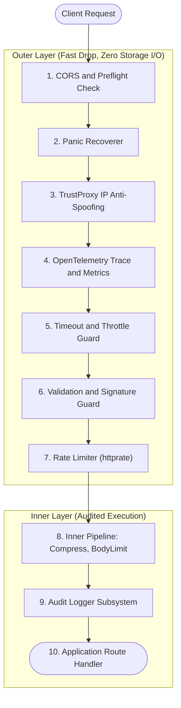
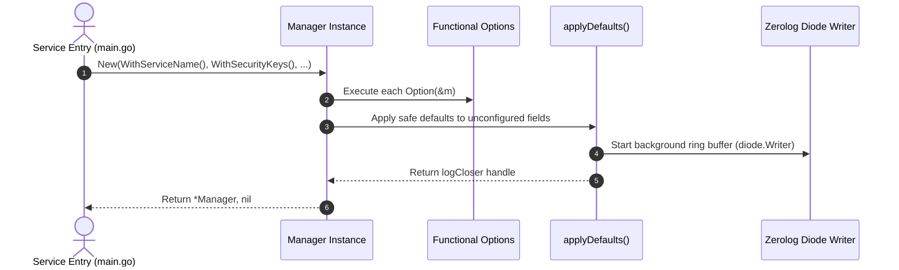
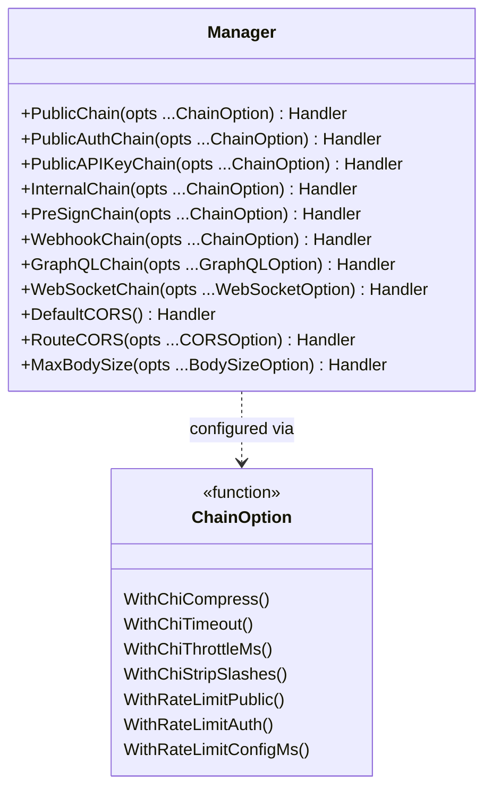
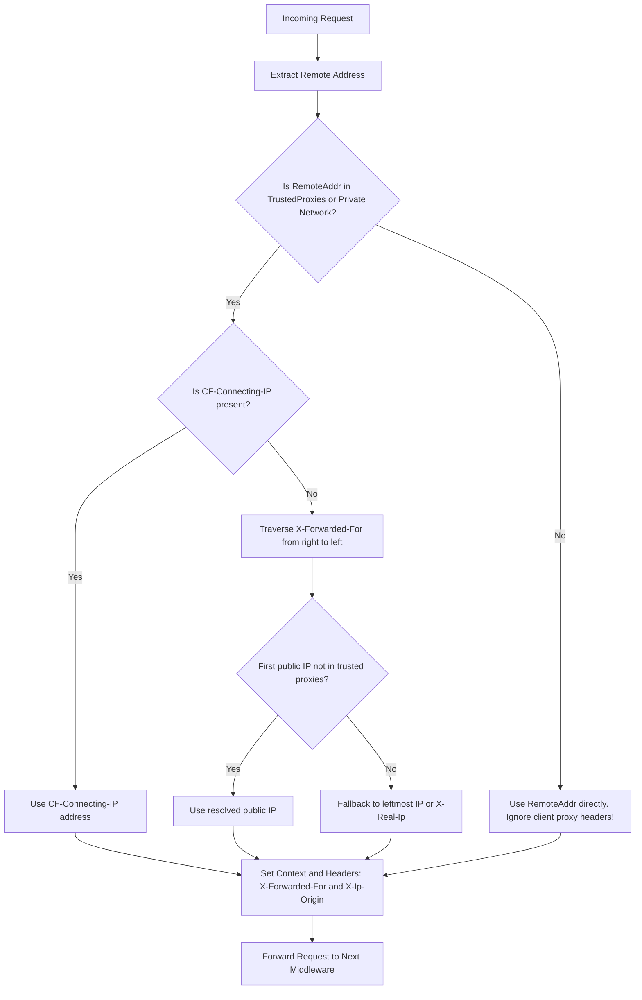
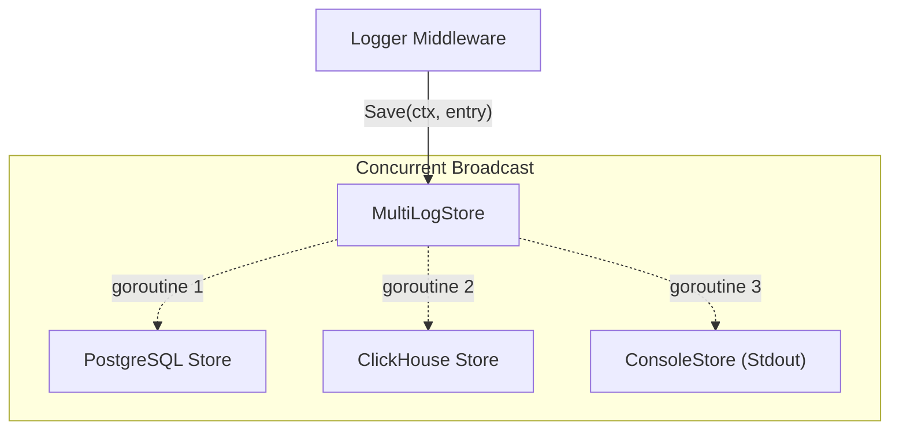

# NVX Go Middleware — Architecture and Technical Reference

This document provides a technical overview of the internal architecture, request lifecycles, execution diagrams, and functional options in `nvx-go-middleware`.

---

## 1. High-Level Architecture

The `nvx-go-middleware` package uses the **Functional Options Pattern** and a **Layered Pipeline Architecture**.
Its primary principle is **Drop Invalid Requests Fast**.
The middleware rejects invalid, unauthenticated, or rate-exceeded requests before requests reach application handlers or audit logging stores.
This approach preserves CPU cycles, memory buffers, and database input/output operations.



The outer layer runs network sanitization, context injection, and security gates.
Requests that fail these checks terminate immediately with standard error payloads.
Requests that pass enter the inner layer where audit loggers record telemetry and responses.

---

## 2. Manager Initialization

The application starts the `Manager` with the variadic constructor `New(opts ...Option) (*Manager, error)`.
Alternatively, applications can construct the manager from an existing configuration struct using `NewWithError(cfg *Config) (*Manager, error)`.



### Complete Manager Options Reference

| Option Builder | Configuration Field | Description (ASD-STE100) |
| :--- | :--- | :--- |
| `WithServiceName(name string)` | `Core.ServiceName` | Sets service identifier for telemetry and structured logs. |
| `WithEnv(env string)` | `Core.Env` | Sets runtime environment (`development`, `staging`, `production`). |
| `WithTelemetry(enable bool)` | `Core.EnableTelemetry` | Enables OpenTelemetry tracing and metric instrumentation. |
| `WithCore(core ConfigCore)` | `Core` | Sets the complete core configuration struct. |
| `WithLogger(l Logger)` | `Logger` | Sets a custom logging interface implementation. |
| `WithLogStore(s LogStore)` | `LogStore` | Sets the audit storage backend. Supports `MultiLogStore`. |
| `WithLogStoreTimeout(d time.Duration)` | `Logging.LogStoreTimeoutMs` | Sets maximum duration for persisting audit log entries. |
| `WithLogHeaders(headers ...string)` | `Logging.LogHeaders` | Configures HTTP headers recorded in audit log records. |
| `WithBodyLogging(req, resp bool)` | `Logging.LogRequestBodies` | Enables or disables payload logging for requests and responses. |
| `WithMaskKeywords(keywords ...string)` | `Logging.MaskKeywords` | Sets sensitive field keywords masked with asterisks. |
| `WithResponseBodyLogLimit(size int64)` | `Logging.ResponseBodyLogLimitSize` | Sets maximum response bytes captured in log records. |
| `WithRequestTimeoutMs(ms int64)` | `Limits.RequestTimeoutMs` | Sets request context cancellation deadline in milliseconds. |
| `WithRequestBodyLimitSize(size int64)` | `Limits.RequestBodyLimitSize` | Sets maximum request body size (defaults to 2GB for uploads). |
| `WithRequestBodyNonFileLimitSize(size int64)` | `Limits.RequestBodyNonFileLimitSize` | Sets maximum non-multipart request body size (defaults to 3MB). |
| `WithSecurityKeys(pub, priv string)` | `Security.PublicKeySignature` | Sets public and private HMAC keys for request verification. |
| `WithTrustedProxies(proxies ...string)` | `Security.TrustedProxies` | Sets trusted proxy IP addresses and network CIDRs. |
| `WithAllowedOrigins(origins ...string)` | `Security.AllowedOrigins` | Sets permitted origins for Cross-Origin Resource Sharing. |
| `WithAllowedContentTypes(types ...string)` | `Security.AllowedContentTypes` | Sets permitted HTTP Content-Type header values. |
| `WithHeadersToRemove(headers ...string)` | `Security.HeadersToRemove` | Sets response headers removed before client delivery. |
| `WithSignatureTimestampExpiredMs(ms int64)` | `Security.SignatureTimestampExpiredMs` | Sets allowable clock drift for request timestamps. |
| `WithHeaderKeys(keys HeaderKeys)` | `Headers.Keys` | Sets custom HTTP header mapping keys. |
| `WithContextInjector(fn)` | `ContextInjector` | Injects custom values into request contexts. |
| `WithConfig(cfg Config)` | Complete Configuration | Sets entire configuration from an existing struct. |

---

## 3. Middleware Chains Architecture

The library provides purpose-built, pre-configured chains for distinct route profiles:



### Pre-Built Route Profiles

1. **`PublicChain(opts ...ChainOption)`**
   - **Target:** Unauthenticated public endpoints (such as `/register`, `/login`, `/catalog`).
   - **Pipeline Execution:** `TrustProxy` ➔ `EnsurePublic` ➔ `RateLimit` ➔ `Logger` ➔ `Handler`.
   - **Characteristics:** Enforces device validation and IP-based rate limiting.

2. **`PublicAuthChain(opts ...ChainOption)`**
   - **Target:** Authenticated user endpoints (such as `/profile`, `/orders`, `/checkout`).
   - **Pipeline Execution:** `TrustProxy` ➔ `EnsurePublicAuth` ➔ `RateLimit` ➔ `Logger` ➔ `Handler`.
   - **Characteristics:** Enforces token verification, session validation, and session-based rate limiting.

3. **`PublicAPIKeyChain(opts ...ChainOption)`**
   - **Target:** External third-party integrations using API keys.
   - **Pipeline Execution:** `TrustProxy` ➔ `EnsurePublicAPIKey` ➔ `RateLimit` ➔ `Logger` ➔ `Handler`.
   - **Characteristics:** Requires valid API keys and scopes rate limits to the key token.

4. **`InternalChain(opts ...ChainOption)`**
   - **Target:** Cluster service-to-service communication.
   - **Pipeline Execution:** `TrustProxy` ➔ `EnsureInternal` ➔ `Logger` ➔ `Handler`.
   - **Characteristics:** Uses private HMAC signatures and bypasses public rate limiters.

5. **`WebhookChain(opts ...ChainOption)`**
   - **Target:** High-throughput third-party callback ingestion.
   - **Pipeline Execution:** `TrustProxy` ➔ `MaxBodySize` ➔ `Logger` ➔ `Handler`.
   - **Characteristics:** Strips heavy rate checks while preserving body size guards and audit logging.

### Route Pattern Rate Limiting (`WithRoutePattern`)

Standard rate limiting keys against exact request paths (`httprate.KeyByEndpoint`).
On parameterized routes (such as `/users/1` and `/users/2`), this fragments counters across individual identifiers.
Use `WithRoutePattern` to inject the normalized route template into the request context:

```go
// Inject route template into context:
r = r.WithContext(middleware.WithRoutePattern(r.Context(), "/api/v1/users/{id}"))

// Or cleanly inject via Chi router context:
mgr, _ := middleware.New(
	middleware.WithContextInjector(func(r *http.Request) *http.Request {
		if pattern := chi.RouteContext(r.Context()).RoutePattern(); pattern != "" {
			return r.WithContext(middleware.WithRoutePattern(r.Context(), pattern))
		}
		return r
	}),
)
```

When present in the request context:
- `resolveEndpoint(r)` uses the injected pattern (`/api/v1/users/{id}`) for the rate limit key.
- If not present, it safely falls back to the Chi route pattern or the standard URI path.
- Applications can inspect the pattern with `RoutePatternFromContext(ctx)`.

---

## 4. IP Anti-Spoofing Algorithm (`TrustProxy`)

The `X-Forwarded-For` header permits client tampering.
`TrustProxy` resolves the real client IP using a secure **right-to-left** traversal.

> [!TIP]
> `TrustedProxies` are pre-parsed during `Manager` initialization into an exact IP hash map (`trustedIPs`) and CIDR slices (`trustedNets`).
> This design eliminates runtime string parsing and heap allocations on hot paths.



---

## 5. Multi-Protocol Support

### A. gRPC (`NewGRPCServer`)
Builds a production `grpc.Server` configured automatically with:
- **Telemetry Handler:** OpenTelemetry `otelgrpc.NewServerHandler()`.
- **Unary Interceptor:** Correlation ID propagation, audit log capture, and panic recovery.
- **Stream Interceptor:** Trace span recording and stream lifecycle logging.

### B. GraphQL (`GraphQLChain`)
- **Query Depth Limiter:** Counts query nesting depth without heavy full AST parsers.
  This limits nested query denial-of-service vectors.
- **Operation Name Extraction:** Extracts `operationName` automatically into the `X-GraphQL-Operation` header for analytics and rate limits.
- **Introspection Blocker:** Middleware `GraphQLBlockIntrospection` rejects `__schema` and `__type` queries in production.

### C. WebSockets (`WebSocketChain`)
- **Pre-Upgrade Origin Validation:** Validates `Origin` against `AllowedOrigins` to prevent Cross-Site WebSocket Hijacking (CSWSH).
- **Pre-Upgrade Authentication:** Validates query tokens or headers via `WithWSAuthenticator` before upgrading connections.
- **Hijack Aware:** Prevents status code collision when connections are hijacked by the WebSocket upgrader.

---

## 6. Audit Logging and Storage Subsystem

Audit log entries use the domain model defined in `model/audit_log.go`.
Entries are persisted via the `LogStore` interface:

```go
type LogStore interface {
	Save(ctx context.Context, entry *model.AuditLog) error
}
```

### Storage Backends

1. **`ConsoleStore`**: Writes structured JSON logs to standard output using the configured logger.
2. **`MultiLogStore(stores ...LogStore)`**: Combines multiple storage implementations into a single interface.
   Broadcasts log entries concurrently across all configured stores.
   Aggregates returned errors using `errors.Join`.



---

## 7. Complete Runnable Reference Implementation

```go
package main

import (
	"log"
	"net/http"

	"github.com/Jkenyut/nvx-go-middleware"
	"github.com/go-chi/chi/v5"
)

func main() {
	// Initialize the middleware manager using functional options
	mgr, err := middleware.New(
		middleware.WithServiceName("order-service"),
		middleware.WithEnv("production"),
		middleware.WithTelemetry(true),
		middleware.WithSecurityKeys("public-secret-key", "private-secret-key"),
		middleware.WithTrustedProxies("10.0.0.0/8", "172.16.0.0/12"),
		middleware.WithAllowedOrigins("https://app.example.com"),
	)
	if err != nil {
		log.Fatalf("failed to initialize middleware: %v", err)
	}
	defer mgr.Close()

	r := chi.NewRouter()

	// 1. Global CORS with preflight handling
	r.Use(mgr.DefaultCORS())

	// 2. Public endpoint with device checks and rate limiting
	r.With(mgr.PublicChain()).Get("/api/v1/products", func(w http.ResponseWriter, r *http.Request) {
		w.Header().Set("Content-Type", "application/json")
		w.Write([]byte(`[{"id":"prod-1","name":"Item"}]`))
	})

	// 3. Authenticated endpoint with token and signature validation
	r.With(mgr.PublicAuthChain(
		middleware.WithRateLimitConfigMs(20, 60000), // 20 requests per minute
		middleware.WithRateLimitAuth(true),
	)).Post("/api/v1/orders", func(w http.ResponseWriter, r *http.Request) {
		w.Header().Set("Content-Type", "application/json")
		w.Write([]byte(`{"order_id":"ord-123","status":"created"}`))
	})

	// 4. File upload endpoint with custom limit
	r.With(mgr.MaxBodySize(
		middleware.WithCustomBodyLimit(50 * 1024 * 1024), // 50MB
	)).Post("/api/v1/upload", func(w http.ResponseWriter, r *http.Request) {
		w.Header().Set("Content-Type", "application/json")
		w.Write([]byte(`{"status":"uploaded"}`))
	})

	log.Println("Server running on :8080")
	if err := http.ListenAndServe(":8080", r); err != nil {
		log.Fatalf("server terminated: %v", err)
	}
}
```
